# PyroScan Dashboard — Design & Reference Spec

**Version:** 0.6.0
**Status:** UI pivot complete + Context/Reconstruction view revision — Context is the default; the photogrammetry patch is revealed on click/zoom. Steps 1–4 applied.
**Related:** `product_requirement_document_pyroscan_prd.1.md`, `agents_guidelines_pyroscan.md`, `spike/README.md`

---

## 1. Purpose

This document fixes the visual and interaction design of the PyroScan commander
dashboard before code is written. It is a 3D-first console: the reconstructed
terrain is the interface, and the panels exist to control and explain it.

---

## 2. References

The references are collected here so the design can be reviewed without the
original links. They are **input**, not templates: layout and density are taken
from them; PyroScan's own palette, data, and wording are not.

### 2.1 FireTrace — 3D wildfire analysis prototype

Source: [Dilum Sanjaya on X, 8 Oct 2026](https://x.com/DilumSanjaya/status/2108241054298415258)
("Played around with an idea for a wildfire analysis tool… Made with Opus 5.5").
Local capture: `spike/ref/x_video.mp4`.

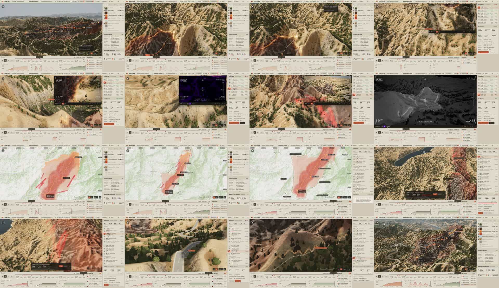

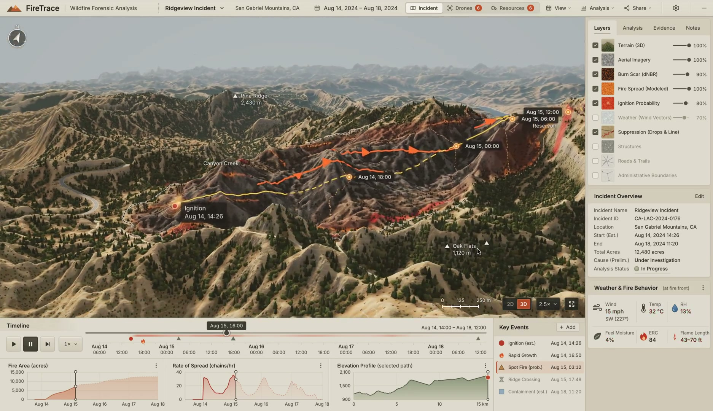

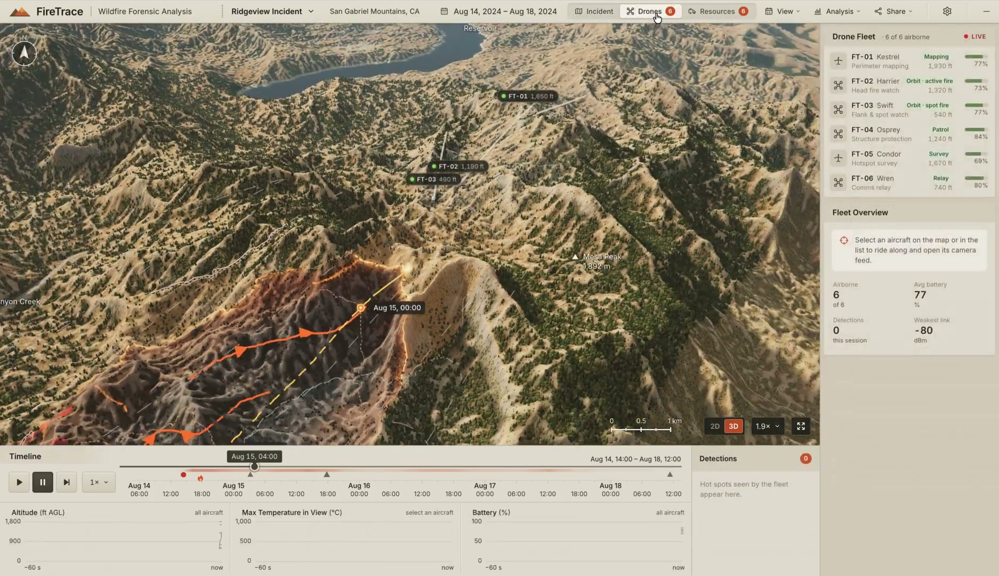

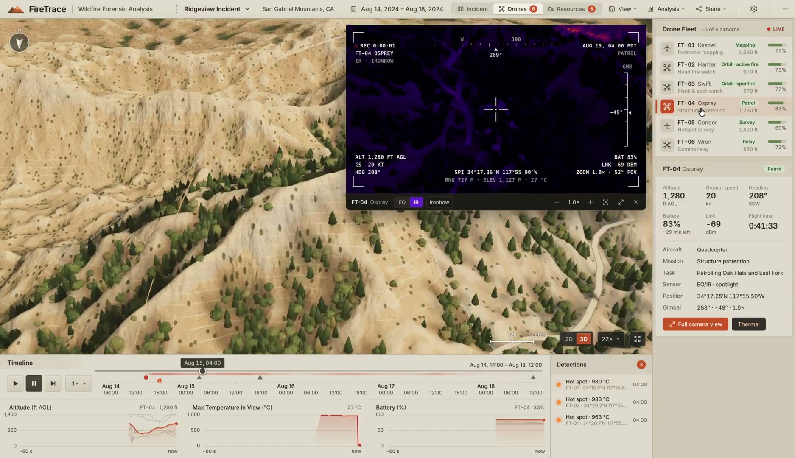

What is taken:

- full-bleed 3D terrain with an oblique camera and atmospheric depth
- layer rows with **checkbox + opacity slider**, not binary toggles
- time-stamped callouts along the fire front
- bottom timeline plus small analytical charts
- right rail with tabs and stacked cards
- warm paper palette + type; incident header + card rail; persisted
  Paper/Obsidian dropdown; elevation profile chart
- 2D/3D toggle, compass, scale, zoom
- persistent status ("Live / Reconnecting")

What is not taken:

- drone fleet management and live IR feed (PyroScan Phase 2, one payload)
- four-day forensic timeline (PyroScan is a 30–60 minute forecast)
- resources, suppression drops, structures (not in v1)

### 2.2 Elevation / point-cloud surface

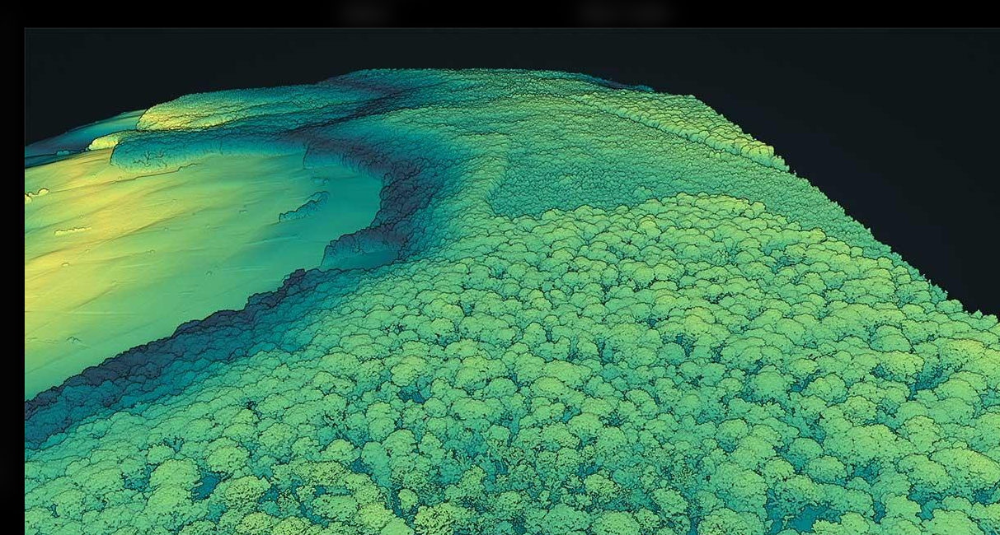

Shows the 3D shape as the data: canopy, slope, a road cut. Informs the
**Depth / elevation** display mode: ramp + contours, not a photo.

### 2.3 Digital photogrammetry process

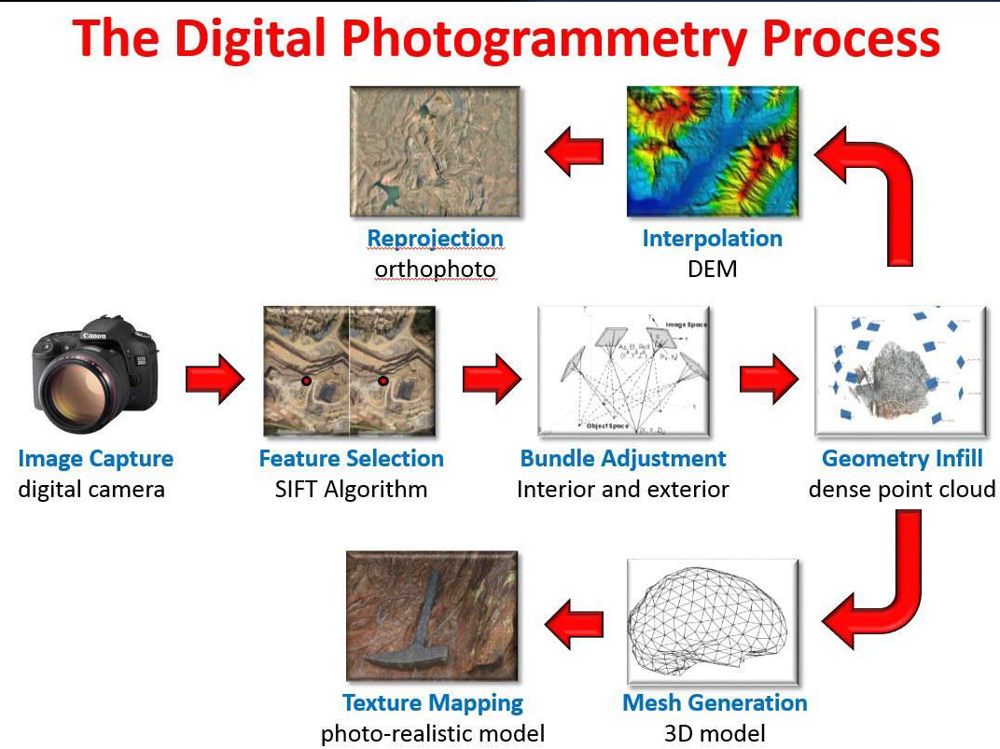

The standard SfM/MVS chain. Informs the **Photogrammetry stage stepper**:
Capture → Features → Bundle Adjustment → Dense Cloud → Mesh → DEM → Ortho.

### 2.4 MODIS fire activity map

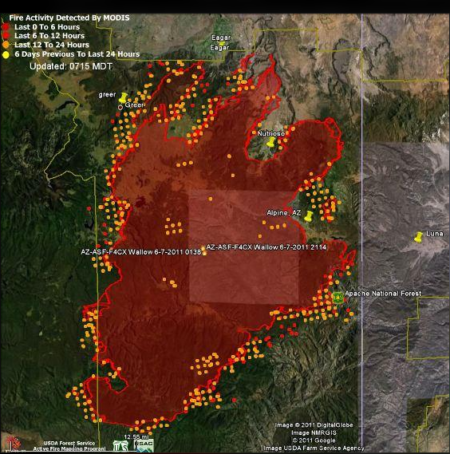

Detections colored by age, a burn perimeter, place labels, update time.
Informs the **hotspot age/confidence dots**, legend, and provenance line.

### 2.5 CHRIS crisis imaging dashboard

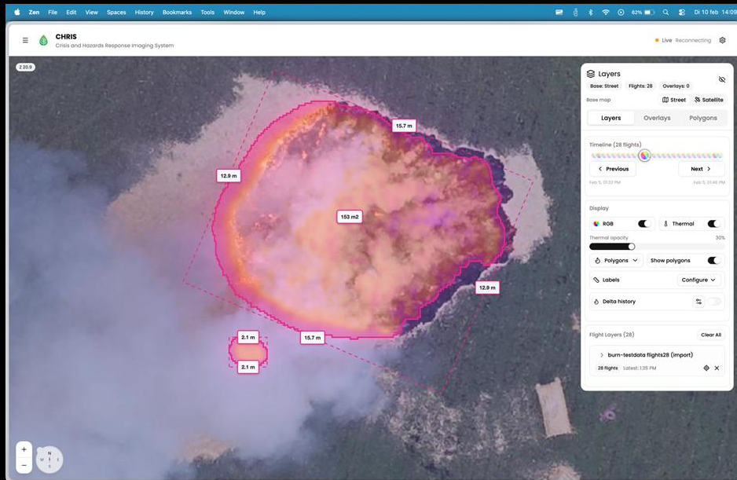

2D map, narrow right rail, floating measurement chips, timeline, layer
counts, "Live / Reconnecting". Informs the **rail density**, **measurement
chips**, and **status language**. Its 2D-only map is the thing this design
corrects.

### 2.6 Burn severity

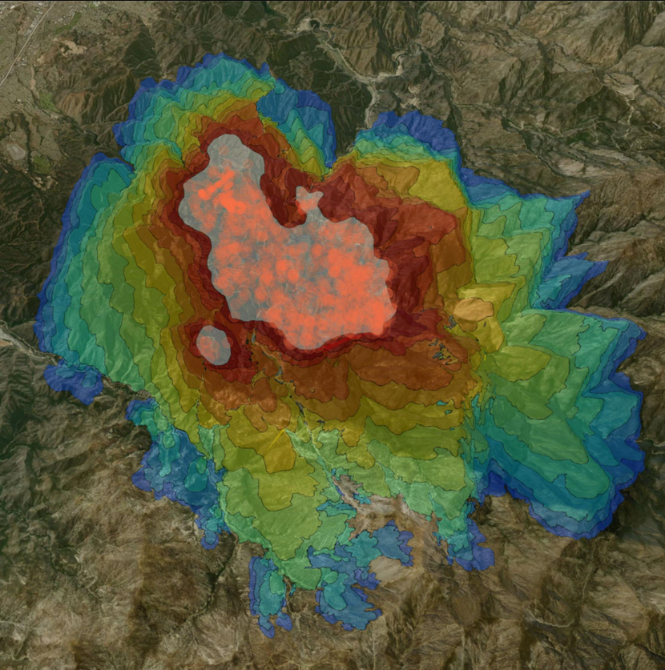

Classified severity bands over a grayscale base. Informs the **Burn severity**
layer for MODE-B: bands, not just a polygon outline.

---

## 3. Locked Decisions

| Decision | Choice |
|---|---|
| Primary medium | **3D**, free orbit; 2D is a toggle, not the default |
| Screen composition | Full-bleed scene + **collapsible right rail** |
| Default view | **Context** — basemap + footprint + hotspot pins; patch hidden |
| Reveal | Click footprint/hotspot/pill or zoom ≤220 m; Context pill/minimap/zoom ≥380 m returns |
| Palette | **Warm paper** default; **obsidian** optional |
| Skin | **Paper / Obsidian** dropdown, persisted in `localStorage` |
| Top bar | Incident name, mission id, date + coordinates, mode, status |
| Context around the patch | **Bright landscape + near-context minimap** (obsidian keeps the studio) |
| Right rail | Tabs: **Layers / Mission / Advisory / Weather**, persistent severity badge |
| Bottom band | **Forecast strip**: now → +60 min, burned area, rate of spread, elevation profile |
| Layers | **Base surfaces** (Elevation / Shaded ortho / Burn severity) + overlays |
| Layer controls | Base radio; overlay checkbox + opacity slider; presets |
| Default state | Elevation base + heat/prediction/hotspots/flight; wind off |
| Data honesty | Fixture layers are labeled **SIMULASI** until the pipeline produces them |

---

## 4. Frame

```
┌──────────────────────────────────────────────────────────────┬──────────────┐
│ PYROSCAN  INCIDENT Brighton Beach  PRE_FIRE  ● DONE  PAPER|OBSIDIAN │  HIGH  ▾     │
├──────────────────────────────────────────────────────────────┤  Layers      │
│                                                              │  Mission     │
│                       3D SCENE                               │  Advisory    │
│   basemap · terrain · heat · wind · prediction · severity    │  Weather     │
│   callouts · chips · legend                                  │              │
│                                                              │              │
│  + −  N       2D | 3D        scale                           │              │
├──────────────────────────────────────────────────────────────┴──────────────┤
│ ▶  ├────────●────────────────┤  now            +30            +60           │
│  Burned area  Rate of spread  Elevation profile  Key events                 │
└─────────────────────────────────────────────────────────────────────────────┘
```

- Top bar: 56 px.
- Right rail: 340 px expanded, collapses to a 44 px handle.
- Forecast strip: 168 px (timeline 48, charts 120).
- Map fills the remainder. All map overlays are absolutely positioned.

---

## 5. Scene

### 5.1 Composition

- **Context (default):** bright cached basemap, area-equivalent mission disc
  (0.71 ha), hotspot pins, `Open reconstruction` pill, photogrammetry card.
  Heat, prediction, flight path, base surfaces, and minimap are hidden.
- **Reconstruction:** patch + base/overlays, camera 220 m / -30°, minimap and
  layer controls return; `Context` pill or zoom-out exits.
- **Paper scene:** bright 1.35 km context mosaic (opaque centre + translucent
  outer ring) from `context_bright.png` (graded cached Esri context), at the
  patch base; CSS horizon haze; sky `#dfe8e3`; camera 300 m / -22° in Context.
  A contact shadow grounds the patch; satellite context also lives in the
  **minimap** (reconstruction only).
- **Obsidian scene:** dark studio floor + faint grid, fading into the void;
  same patch, shadow, and minimap.
- **Mission patch:** 384² mesh from the real ODM DSM, real ortho texture. Paper
  uses 6%-feathered base variants with a 1.55 tint.
- **Base surface:** one of four full-surface materials (terrain hybrid,
  elevation, shaded ortho, burn severity) — reconstruction only.
- **Overlays:** heat as an offset mesh; prediction as per-position-height
  fronts; wind as 3D arrows; hotspots as ringed pins (hotspots also in Context).
- **Grounding:** contact shadow under the patch; quiet vignette.
- **Limitation:** the context is a flat 30 m basemap, not a context DEM, and
  there is no real sun/shadow model. The patch remains a high-res inset.

### 5.2 Base surfaces

| Surface | Encoding | Default |
|---|---|---|
| Terrain | shaded ortho + hillshade + subtle tint + **2 m contours / 10 m index** | on |
| Elevation | hillshade + hypsometric tint + 2 m contours | off |
| Shaded ortho | orthophoto multiplied by hillshade (NW light) | off |
| Burn severity | 5 classes, hillshaded | off |

### 5.3 Overlays

| Overlay | Encoding | Default |
|---|---|---|
| Heat | 5-band detection density + isolines | on, 45% |
| Wind | 3D arrows with arrowheads, speed legend | off, 35% |
| Prediction | **Now / +30 / +60** fronts, solid outlines, labelled | on |
| Hotspots | ringed pins, one label to avoid clutter | on |
| Flight path | dashed polyline | on |

### 5.4 Legibility rules

- **One base at a time.** An overlay is never the only thing on screen.
- Contour interval must fit the relief: a 19 m patch uses 2 m contours and a
  10 m index, not 50 m (which produced zero index lines).
- Base textures at 2048–4096; mission mesh at 384²; camera distance clamped
  150–1600 m so you cannot zoom past the data.
- A real legend with ramps, units and class labels, not single swatches.
- Presets: **Terrain / Fire / Forecast / Burn**.

### 5.5 Map annotations

- Ignition point: ring + callout.
- Front callouts: **Now**, **+30 min**, **+60 min**.
- Orange chevrons along the predicted front.
- Yellow dashed modeled path.
- Chips: burned area, distance to nearest asset, slope at hotspot.
- Context: area-equivalent footprint disc + `ODM reconstruction` label;
  hotspot pins; `Open reconstruction` pill.
- Minimap: hidden in Context; in Reconstruction, near-context crop with the
  mission footprint; click to return to Context.
- Legend: Context shows footprint/hotspot/context; Reconstruction shows layer
  colors + "SIMULASI" marker when fixtures are shown.

### 5.6 Camera

- Free orbit: drag = yaw/pitch, wheel = zoom, tilt clamped 15°–85°.
- Context default: 300 m / -22°. Reconstruction: 220 m / -30°.
- Enter Reconstruction by footprint/hotspot/pill or zoom ≤220 m; exit by
  Context pill, minimap, or zoom ≥380 m.
- 2D/3D toggle: pitch −89° (top-down) vs the mode's oblique pitch.
- Compass, zoom, reset.

---

## 6. Rail

### 6.1 Severity badge

Always visible above the tabs. Text + color, never color alone:

`LOW` green · `MEDIUM` amber · `HIGH` orange · `CRITICAL` red.

### 6.2 Tabs

- **Layers** — Context: photogrammetry card + `Open reconstruction`; controls
  hidden. Reconstruction: base rows, presets, overlays (checkbox + opacity),
  legend below.
- **Mission** — incident ID, mode, area, align ratio, processing time,
  photogrammetry stage stepper, rerun.
- **Advisory** — severity, narrative, action list, "draf — verifikasi lapangan",
  model + seed + `prompt_sha`, dropped IDs.
- **Weather** — wind speed/direction, temperature, humidity, source, age.

### 6.3 Cards

Small, 12–13 px, 1 px borders, 6 px radius, no heavy shadows. Numbers use a
mono face and tabular figures.

---

## 7. Forecast strip

- Play/pause and step.
- Range 0–60 min; default cursor at 0.
- Moving the cursor updates: prediction front visibility, burned-area readout,
  map callouts.
- Sparklines: **Burned area (ha)**, **Rate of spread (m/min)**, and
  **Elevation profile**.
- The elevation profile samples the **steepest cardinal/diagonal transect**
  through the mission centre (N–S on Brighton, 157–173 m). The 45° spread
  bearing is flat (161–162 m), so it is not used. It is static terrain; the
  forecast cursor does not apply to it.
- Key events: ignition, first detection, predicted ridge crossing, advisory.
- Data source is labeled: model fixture vs. simulation engine.

---

## 8. Visual tokens

```
--ground     #efe9dc   (app ground)
--charcoal   #f7f3ea   (top bar, rail, strip)
--elevated   #fffdf7   (cards)
--line       #d8cfbc
--silver     #575248
--text       #26231d
--muted      #6f685c
--amber      #a05a10
--flame      #b0401c
--red        #a9342a
--green      #3f7353
--blue       #2f648c
```

Type: Segoe UI/Inter for UI, Cascadia Mono/Consolas for numbers. Tabular
numerals in stats and charts.
Sizes: 11 px labels, 12–13 px body, 15 px section titles, 22 px mission title.
Uppercase labels get 0.08em tracking.

Paper tokens are the default. The top-bar **theme dropdown** (Paper /
Obsidian) sets `data-theme="obsidian"` on `<html>`; the obsidian block restores
the dark tokens, bright chart colors, and dark map controls. Chart and
prediction colors are tokens (`--chart-*`, `--pred-*`) so the SVG charts
re-render on toggle. Paper uses the bright landscape; obsidian keeps the dark
studio.

Motion: 160–220 ms ease-out for panels, 300 ms camera easing, 1.2 s pulse on
active hotspots, drifting wind arrows. All disabled under
`prefers-reduced-motion`.

---

## 9. States

- **Boot:** basemap and terrain loading, skeleton rail.
- **No mission:** centered prompt + "Buka Photogrammetry Manager".
- **Processing:** stage stepper live, terrain placeholder, SSE progress.
- **Failed:** stage, error message, retry.
- **Done:** full scene.
- **Stale:** weather age > 30 min, amber banner.
- **Offline:** "Offline — cached data" pill.

---

## 10. Data

Real for the prototype:

- `spike/web/data/heightmap.json` — ODM DSM, 256² static fallback
- `spike/web/data/ortho.webp` — ODM orthophoto
- `spike/web/data/ortho_shaded.webp` — hillshaded orthophoto
- `spike/web/data/elevation.png` — topographic base, 2048²
- `spike/web/data/severity_base.png` — 5-class severity base, 2048²
- `spike/web/data/context_bright.png` — graded 1.35 km context, 2048², alpha fade
- `spike/web/data/*_paper.*` — 6%-feathered paper base variants (terrain,
  elevation, severity, shaded ortho)

Fixtures (labeled SIMULASI until the pipeline exists):

- `fixtures.json` — mission, weather, advisory, hotspots, prediction steps,
  wind grid, key events, chart series
- `heat.png` — 5-band detection density overlay
- `studio_floor.png` — dark floor + faint grid for the obsidian theme
- `shadow.png` — contact shadow
- `context_near.jpg` — near-context minimap crop
- `context.jpg` — cached 1.35 km basemap

No runtime network calls. Basemap attribution is displayed in the Weather or
Mission card.

---

## 11. Prototype scope

Build a **static HTML/CSS/JS shell** in `spike/web/` reusing the existing
Cesium 1.147 build. This validates the design before the React/Vite/Tailwind
port. The production frontend will keep the same components and tokens.

Acceptance:

1. Full-bleed 3D, free orbit, 2D toggle.
2. Studio floor + minimap + mission patch in the right place.
3. Base surfaces switch; overlays toggle and opacity-change.
4. Rail tabs populated; severity visible.
5. Forecast strip moves the prediction and charts cursor.
6. p95 frame time measured with all layers on.
7. Zero external requests.
8. Screenshot evidence.

---

## 12. Risks

1. **Basemap licensing.** Esri export is prototype-only with attribution; the
   product needs Sentinel-2 or an offline tile pack.
2. **Studio floor edges.** The floor fades through alpha; if the falloff is too
   sharp it reads as a disc. Tune the radial fade.
3. **Six layers at once.** Opacity defaults are a starting point; measure and
   tune. The legend must make the composition legible.
4. **Fixtures read as real.** Every fixture layer shows SIMULASI in the legend
   and provenance card.
5. **Patch scale.** A 100 m patch is small; the minimap must not imply
   reconstruction beyond the measured footprint.

---

## 13. Prototype evidence

Built as a static shell at `spike/web/dashboard.html`:
`http://127.0.0.1:8080/dashboard.html`.


Real: Brighton Beach orthophoto, DSM mesh, bright paper landscape, dark
obsidian studio.
Fixtures (SIMULASI): heat, wind, prediction, severity, weather, advisory.

Verified at 1600×900 in Edge: rail tabs, forecast scrub to +60, top-down
toggle, rail collapse, zero external requests, incident header, incident card,
three-chart forecast strip, persisted Paper/Obsidian theme dropdown, the
Context/Reconstruction switch, footprint/hotspot click, zoom thresholds, and
the minimap return. Context p50 14 ms / p95 21 ms; Reconstruction p50 21 ms /
p95 28 ms; HUD 20–28 ms. The browser used Intel UHD, not the RTX 4060; the
33 ms target is met in this run. The shell is a design prototype; the
React/Vite/Tailwind port keeps the same tokens and components.

### Context + reconstruction (Steps 1–4 + view revision)


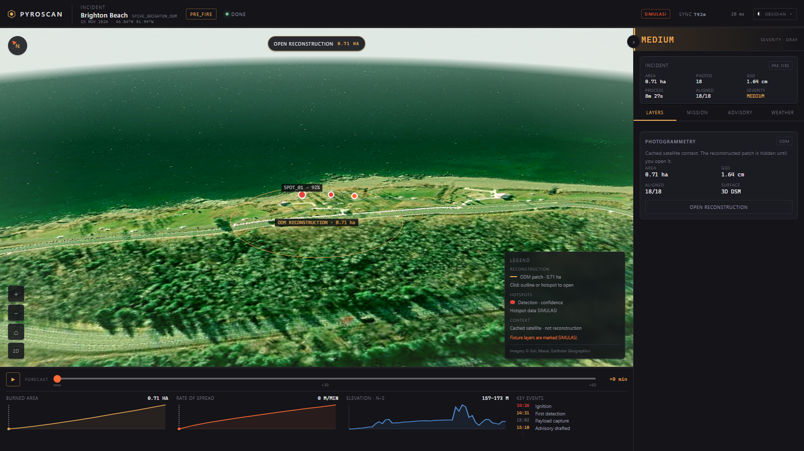

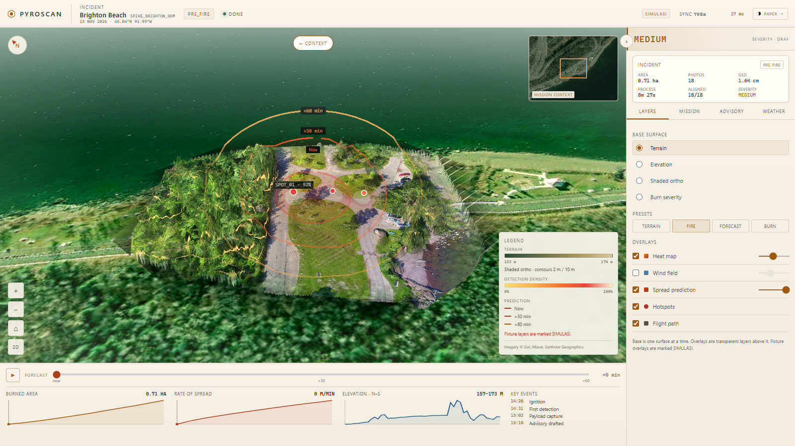

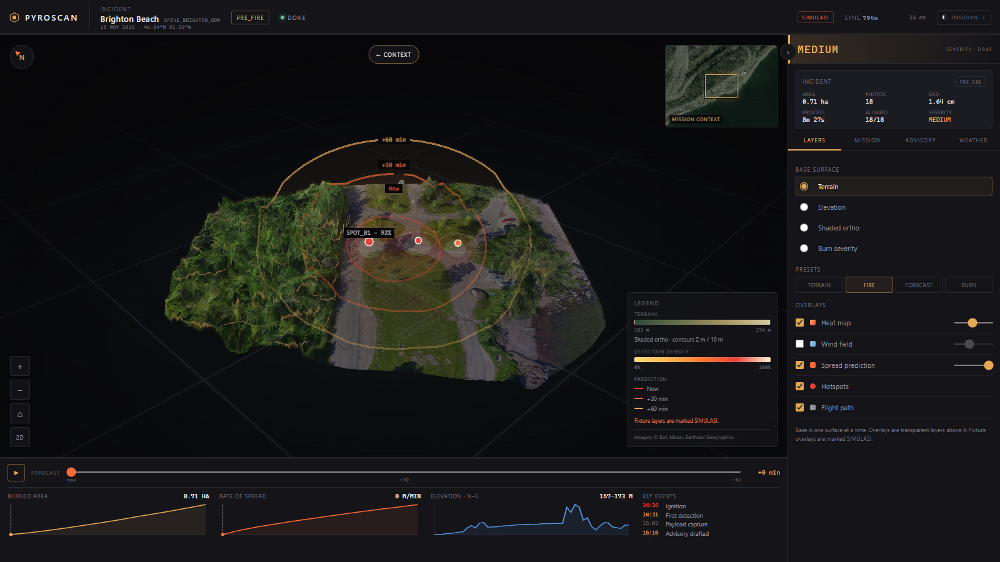

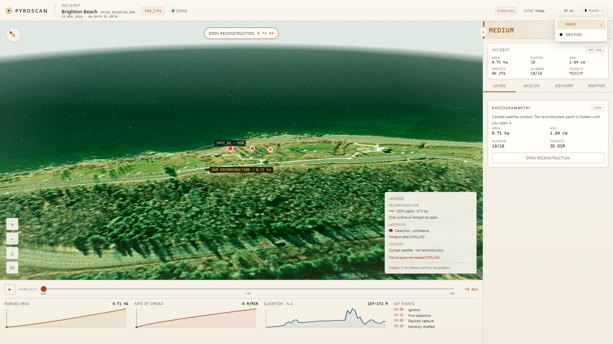

**Context** is the default: bright basemap, area-equivalent mission disc and
label, hotspot pins, and an `Open reconstruction` pill. Heat, prediction,
flight path, base surfaces, and minimap are hidden. Clicking the disc, a
hotspot, the pill, or zooming past 220 m opens **Reconstruction** at
220 m / -30°; the `Context` pill, minimap, or zooming out past 380 m returns.

Paper uses the bright 1.35 km context mosaic (opaque centre + translucent
alpha ring) with a CSS horizon haze; the mission patch uses feathered paper
base variants. Obsidian keeps the dark studio floor and grid. The top-bar
**theme dropdown** (Paper / Obsidian) persists in `localStorage` and switches
both chrome and scene; Context stays bright in both themes. The incident
header shows the name, mission id, date and coordinates; the card above the
tabs summarizes area, photos, GSD, processing, alignment, and severity. The
forecast strip has burned area, rate of spread, an N–S elevation profile
(steepest transect, 157–173 m), and key events.

### Live data

`server/import_mission.py` imports the existing ODM task into SQLite and writes
mission assets. The same dashboard then runs from the API at
`http://127.0.0.1:8000/dashboard.html`.


The rail is fed by SQLite: 18/18 aligned, 0.71 ha, 8m27s, 1.64 cm GSD,
severity **MEDIUM** from the engine, and +60 min = 2.09 ha / 15 m/min. Heat,
wind, severity, prediction geometry, weather and advisory remain marked
SIMULASI where they are still fixtures. Pipeline details and gaps:
`server/README.md`.

### Legibility revision

The first shell made Depth a transparent overlay. With the ortho switched off
it rendered as yellow contour noise over the basemap. Fixed by:

- four base surfaces instead of one overlay stack;
- hillshade + hypsometric tint + **2 m contours / 10 m index**;
- a shaded orthophoto base and a 5-class severity base;
- 5-band heat, outlined prediction fronts, ringed hotspots;
- real legends with ramps, units and class labels;
- a **hybrid Terrain base** (shaded photo + tint + contours) because pure
  elevation was flat on paved areas;
- a **studio floor** (dark radial gradient + faint grid) for obsidian; paper
  uses the bright context mosaic; contact shadow and near-context minimap;
- 2048–4096 px base textures, 384² mesh, camera 300 m default (150–1000 m
  clamp);
- presets: Terrain / Fire / Forecast / Burn.
- **Context default:** the patch is hidden until the footprint/hotspot/pill or
  zoom reveals it; hotspots stay visible; base/overlay controls only in
  Reconstruction. This separates the basemap from the measured patch.

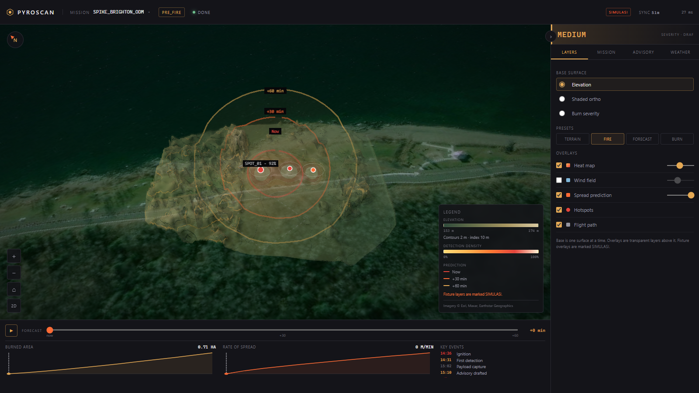

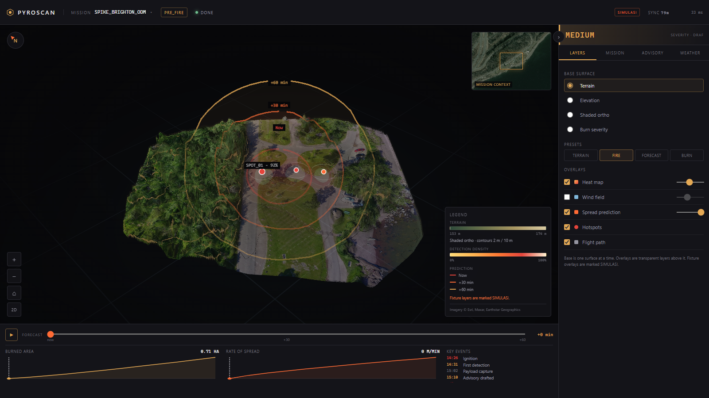

Measured at 1600×900: Context p50 14 ms / p95 21 ms; Reconstruction p50 21 ms
/ p95 28 ms; HUD 20–28 ms on Intel UHD (not the RTX 4060). The 33 ms target is
met in this run; re-check on the discrete GPU.
