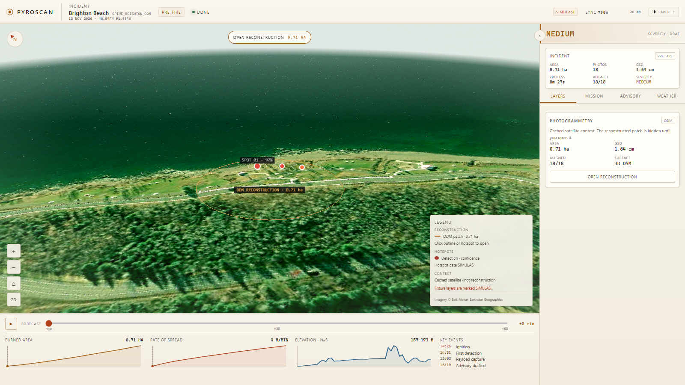
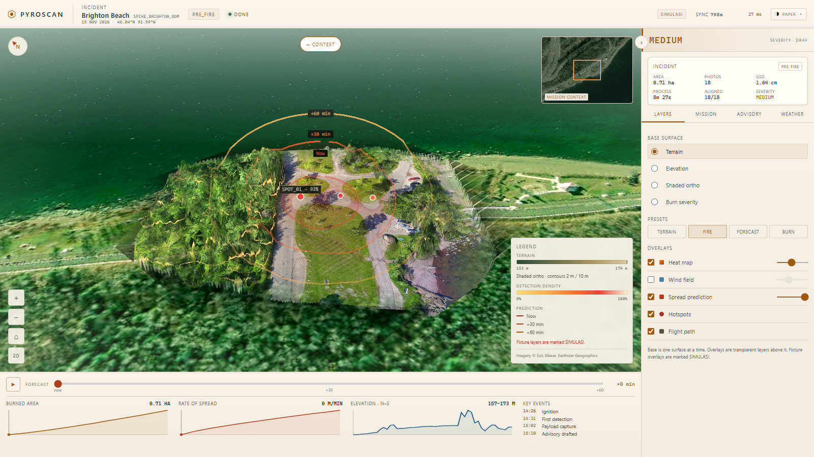

# PyroScan

Offline forest-fire mission console: drone photogrammetry, a Cesium 3D mission
patch, and a **Context → Reconstruction** view that keeps the basemap and the
measured reconstruction separate.





## What it does

- **Context** is the default: cached satellite basemap, an area-equivalent
  mission footprint, hotspot pins, and an `Open reconstruction` action.
- Click the footprint, a hotspot, the action, or zoom in to open the
  **Reconstruction**: the ODM patch, terrain/elevation/severity bases, heat,
  prediction fronts, hotspots, and flight path.
- A `Context` pill, the minimap, or zooming out returns to the overview.
- Paper and Obsidian themes are switchable and persist locally. Context stays
  bright in both themes; Obsidian uses the dark studio in Reconstruction.
- The mission patch is real ODM output. Heat, wind, prediction, severity,
  weather, and advisory are fixtures and are marked **SIMULASI**.

## How it is made

The runtime is a FastAPI + SQLite server in `server/` and a static
HTML/CSS/JS + Cesium dashboard in `spike/web/`. The server imports an ODM task,
builds mission assets, runs DEM fusion and the deterministic spread model, and
serves the mission payload and SSE endpoint. The dashboard is a local Cesium
viewer with a custom camera, a paper/obsidian token system, and an explicit
Context/Reconstruction scene state.

The context image is a **cached Esri World Imagery crop**, not Google Maps and
not a reconstruction. It is a flat basemap at a different resolution/date from
the 1.64 cm ODM patch. The patch is feathered into it, but the two are not the
same capture. See `Docs/dashboard_design.md` for the full design and
`Docs/HANDOFF.md` for the engineering state.

## Run locally

Requires Python 3.11+ (developed on Python 3.14). The repository includes a
preloaded demo database and prebuilt mission assets, so NodeODM and Ollama are
not required for the dashboard.

```powershell
python -m pip install fastapi uvicorn requests numpy pillow tifffile
python -m uvicorn server.api:app --host 127.0.0.1 --port 8000
```

Open `http://127.0.0.1:8000/dashboard.html`.

Static fallback without the API (fixtures only):

```powershell
python -m http.server 8080 --directory spike/web
```

Open `http://127.0.0.1:8080/dashboard.html`.

Cesium 1.147 is bundled under `spike/web/cesium/`; no CDN or Cesium ion is used.
All runtime requests are local. `spike/data/` (the raw drone photos and ODM
project) and the reference video are intentionally not committed.

## Project structure

```text
server/                 FastAPI, SQLite, ODM client, fusion, spread, advisory
spike/web/              dashboard shell, Cesium bundle, dashboard assets
spike/missions/         prebuilt mission assets (heightmap, ortho, mesh)
spike/tools/            ODM/dashboard asset builders
simulation/             payload 3D studio prototype
Docs/                   design spec, handoff, reference gallery
```

## Data and attribution

- Brighton Beach drone sample processed with NodeODM/ODM.
- CesiumJS 1.147, bundled locally.
- Cached context: Esri World Imagery / Maxar / Earthstar Geographics
  (`Imagery © Esri, Maxar, Earthstar Geographics`). Prototype use only; the
  product path needs Sentinel-2 or an offline tile pack.
- FireTrace by Dilum Sanjaya inspired the layout and interaction direction:
  <https://x.com/DilumSanjaya/status/2108241054298415258>. The implementation is
  original and independent.
- The reference video is not included in the repository.

## Status and limitations

This is a working vertical slice, not a production deployment. Known gaps:

- YOLO fire/smoke detections are not wired; hotspot positions are fixtures.
- The watcher/NodeODM path has not been exercised on a new flight.
- Heat, wind, prediction geometry, severity, weather, and advisory are fixtures.
- The context basemap is flat; there is no context DEM or real sun/shadow model.
- The context footprint is an area-equivalent disc, not the exact ortho
  boundary.
- No auth, PWA, or React/Vite port yet. GitHub Pages is not applicable because
  the live path needs FastAPI + SQLite.

## License

No license file is included. Reuse rights are not granted explicitly.
